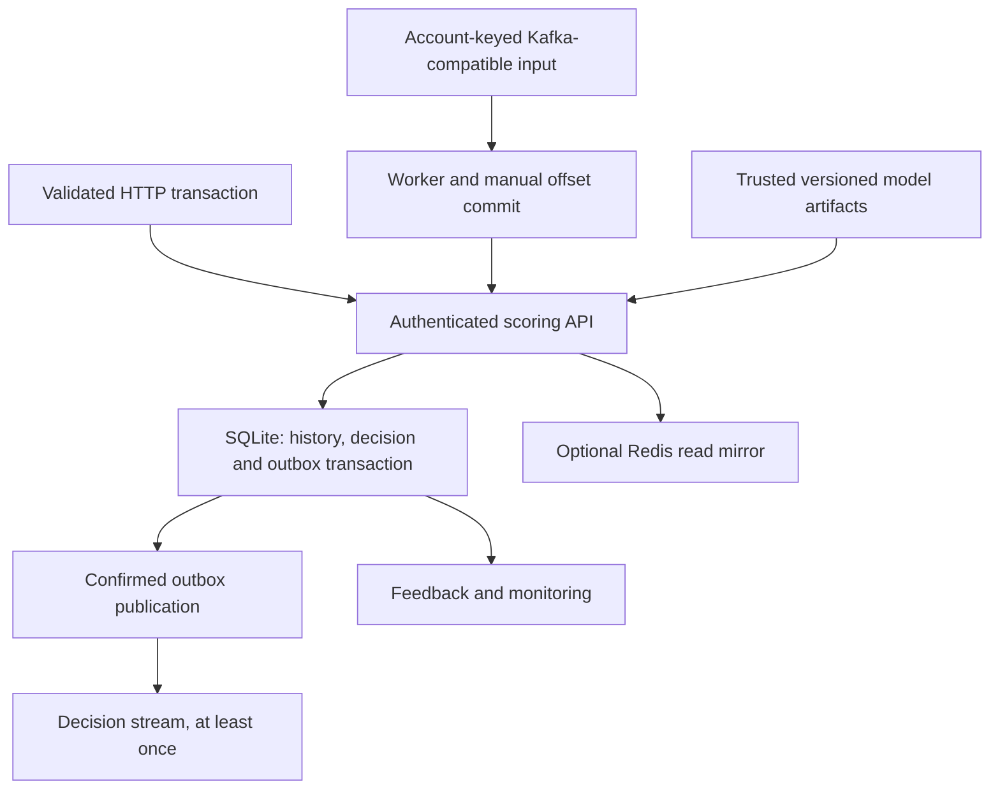

# Sentinel — fraud scoring with repeatable decisions and honest streaming guarantees

[](https://github.com/Jill-Vekariya/sentinel-fraud-platform/actions/workflows/ci.yml)

[](LICENSE)

**[Try the browser demo](https://jill-vekariya.github.io/sentinel-fraud-platform/)** · [Real-data benchmark](docs/REAL_BENCHMARK.md) · [Architecture](docs/ARCHITECTURE.md) · [Runbook](docs/RUNBOOK.md)

## The problem

A fraud model is only half of a fraud system. The other half is the plumbing: a payment that gets retried must receive the same decision it got the first time, a crashed publisher must not lose a decision, and the account history the model scores against must be updated atomically with the decision itself. Sentinel is a complete scoring service that takes those guarantees seriously, on top of a model evaluated on real anonymised card transactions.

## What I built

- **The model:** an XGBoost classifier blended (95/5) with an Isolation Forest anomaly signal and review rules, with Tree SHAP explanations for the classifier margin.
- **The offline benchmark:** five approaches on the 284,807-row anonymised card dataset, chronological splits, validation-selected thresholds, and a cost explorer for assumed fraud/false-positive costs.
- **Idempotent decisions:** identical retries return the original decision and model version; a changed payload under the same ID returns HTTP 409; events older than the account watermark are rejected.
- **A transactional outbox:** account history, decision and outbound event commit in one SQLite transaction, then publish to a Kafka-compatible stream at least once. A worker that fails on a message retains it instead of polling past it.
- **Operations:** versioned model promotion with validation gates, feedback ingestion, PSI drift heuristics, an optional Redis read mirror, and a browser demo with a parity check against the Python model.

## Results

| Measurement | Result | Scope |
| --- | --- | --- |
| [Real-data benchmark](docs/REAL_BENCHMARK.md) | **XGBoost holdout PR-AUC 0.7639** on 284,807 transactions | Chronological split; cost figures are scenarios, not realised savings |
| [Bounded load test](docs/LOAD_SECURITY.md) | 300/300 requests in two runs; p95 987 ms and 1,269 ms with ten clients | Single local API; no latency SLA claimed |
| [Broker verification](docs/FINAL_VERIFICATION.md) | 100 transactions scored and consumed end to end | Local Docker with Redpanda |
| [Streaming recovery](docs/STAGE4_STREAM_RECOVERY.md) | Failed input retried before a later offset; uncertain deliveries retained | Regression tests failed before the fix and pass after |

## Where this applies

- **Payments and fintech:** UPI and card processors face exactly this retry-and-duplicate problem; idempotency keys and outbox patterns are what their APIs are built on.
- **Any event-driven ML service:** the "decide once, publish at least once, let consumers deduplicate" contract applies to credit decisions, content moderation and alerting alike.
- **Model governance:** promotion gates, versioned artifacts and feedback-joined-to-version are the parts regulators and risk teams ask about.

## Architecture



[Design decisions](docs/DESIGN_DECISIONS.md) · [Architecture and trade-offs](docs/ARCHITECTURE.md) · [Validation conditions](docs/VALIDATION.md)

## Quick start

Requires Python 3.12 (Linux x86-64 for the hash-locked install; other platforms see the [runbook](docs/RUNBOOK.md)).

```bash
git clone https://github.com/Jill-Vekariya/sentinel-fraud-platform.git
cd sentinel-fraud-platform
python3.12 -m venv .venv
.venv/bin/python -m pip install --require-hashes -r requirements-linux-py312.lock
.venv/bin/python -m fraud.train --promote                       # trains and promotes a synthetic model
.venv/bin/python -m uvicorn fraud.api:app --host 127.0.0.1 --port 8000   # http://127.0.0.1:8000/docs
```

Local demo key: `local-demo-change-me`. In a second terminal, `.venv/bin/python -m scripts.demo --count 200` scores synthetic events. Full streaming topology with Docker: [walkthrough](docs/DEMO_WALKTHROUGH.md). Windows launchers: [`scripts/windows/`](scripts/windows/). Tests: `.venv/bin/python -m pytest -q`. Everything else: [reference guide](docs/REFERENCE.md).

## What I learned

<!-- Rewrite these in your own words before you point a recruiter here. Short, specific, first person. -->

- Exactly-once delivery is a promise you cannot keep across a crash; design for duplicates and say so.
- An empty producer queue is not proof of delivery. The fix was requiring a delivery callback.
- PR-AUC on a chronological split tells a much less flattering story than ROC-AUC on a random one, and it is the right story.

## Limits

- The 95/5 blend is a ranking signal, not a calibrated fraud probability.
- Account histories keep at most 24 hours / 1,000 events; very high-rate accounts lose part of their window.
- Single serialised SQLite writer; Redis is a disposable mirror, not a second ledger.
- Model artifacts are pickles: load only ones you built. Checksums do not make hostile files safe.

[Operating limits in full](docs/REFERENCE.md#operating-limits) · [Deployment demo](docs/DEPLOYMENT_DEMO.md)


## License

[MIT](LICENSE). The anonymised transaction dataset keeps its source terms.
