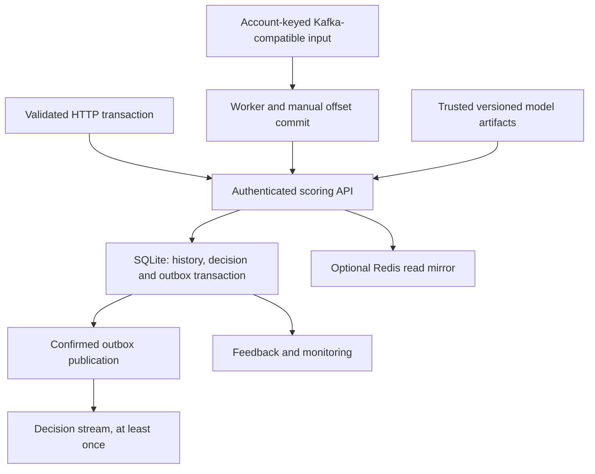

# Sentinel

**Fraud scoring with transactional decisions, replay safety and an explicit at-least-once streaming contract.**

Sentinel combines XGBoost output, an Isolation Forest anomaly percentile and review rules. One SQLite transaction checks event identity, computes features from bounded account history and commits the decision, history and output outbox together. Optional Kafka-compatible input and Redis reads extend the local API without making them correctness authorities.

[Browser demo](https://jill-vekariya.github.io/sentinel-fraud-platform/) · [Dashboard video](docs/sentinel-dashboard-demo.mp4) · [Interview guide](docs/INTERVIEW.md) · [Real-data benchmark](docs/REAL_BENCHMARK.md)

The browser edition runs exported synthetic inference and classifier explanations, plus a separate real-data cost explorer. It does not host the Python/Kafka backend. [Demo/transcript](docs/DASHBOARD_DEMO.md) · [Browser model parity](docs/browser-model-parity.json).

## Architecture



Identical retries replay the original decision/model version; changed payloads under the same ID return 409. Events older than the account watermark are rejected. Publication and SQL delivery marking are separate, so output can duplicate after a crash; downstream consumers must deduplicate. [Architecture and trade-offs](docs/ARCHITECTURE.md).

## Quick start: API without a broker

Requires Git, Python 3.12 and dependency-download access. Linux x86-64 commands, from a new clone:

```bash
git clone https://github.com/Jill-Vekariya/sentinel-fraud-platform.git
cd sentinel-fraud-platform
python3.12 -m venv .venv
.venv/bin/python -m pip install --require-hashes -r requirements-linux-py312.lock
.venv/bin/python -m fraud.train --promote
.venv/bin/python -m uvicorn fraud.api:app --host 127.0.0.1 --port 8000
```

Open `http://127.0.0.1:8000`; the API explorer is `/docs`. The local demo key is `local-demo-change-me`. Training creates a synthetic model first; a Git clone does not include generated model files. Other platforms use the separately resolved `requirements.txt` path in [the runbook](docs/RUNBOOK.md), rather than claiming the Linux wheel lock verifies Windows.

In a second terminal, run `.venv/bin/python -m scripts.demo --count 200` for a local serial scoring/feedback example. It uses synthetic events and prints that run's HTTP timings. Existing checkouts should use owned `DATA_DIR`/`MODEL_DIR` paths and retain previous models/data.

For the full streaming topology, start Docker Linux/Compose v2 and follow [the walkthrough](docs/DEMO_WALKTHROUGH.md): create `.env` only if absent, run `docker compose up --build -d`, then `docker compose run --rm --no-deps producer`. Stop with `docker compose down`, preserving volumes. The trainer precedes API startup; producer messages are keyed by account. Reusing explicit producer seeds can conflict with old IDs.

## Results and verification

| Evidence | Recorded observation | Limit |
| --- | --- | --- |
| [Historical broker verification](docs/FINAL_VERIFICATION.md) | 100 transactions scored and decision output consumed | Local Docker/Redpanda integration at the recorded source |
| [Bounded load](docs/LOAD_SECURITY.md) | Two runs completed 300/300 requests each; ten-client p95 987 ms and 1,269 ms | Single local API, bounded workload; no guaranteed sub-100 ms latency |
| [Real-data benchmark](docs/REAL_BENCHMARK.md) | Five approaches on 284,807 anonymized rows, chronological splits and validation-selected thresholds | Offline PCA-feature models differ from the synthetic serving model; cost scenarios are assumptions |
| [Stage 4 local review](docs/INTERVIEW.md) | 21 selected transactional/API/boundary/mocked-stream tests passed | No new broker, external financial event or production outcome |

For development, after runtime installation:

```bash
.venv/bin/python -m pip install -r requirements-dev.txt
.venv/bin/python -m pytest -q
.venv/bin/python -m ruff check fraud scripts tests
.venv/bin/python -m ruff format --check fraud scripts tests
python scripts/check_links.py
```

[Validation conditions](docs/VALIDATION.md) distinguish synthetic holdout, real-data offline evaluation, browser parity and HTTP measurements. [Current status](docs/CURRENT_STATUS.md) documents optional DOM checks. A configured workflow is not evidence of a successful run at a later revision.

## Operating limits

- Scoring holds a serialized SQLite writer transaction. Redis is a disposable mirror, not a second authoritative ledger. Account histories retain at most 24 hours/1,000 events; high-rate accounts can lose part of their window through truncation.
- The 95/5 classifier/anomaly blend is a ranking signal, not a calibrated fraud-loss probability. Tree SHAP explains the classifier margin, not the anomaly component, rules or causal effects.
- Feedback can be selectively labeled; PSI is an investigation heuristic. Retraining creates candidates, with explicit promotion and demo validation gates. There is no automatic scheduling/promotion.
- Production mode requires `FRAUD_ENV=production` and a private non-demo `API_KEY` of at least 24 characters. Actual bodies are capped at 65,536 bytes before parsing. These guards do not establish a complete public security/retention policy.
- Load only trusted local model artifacts: checksums do not make attacker-controlled pickle files safe. Concurrent model promoters and shared outbox publishers need additional coordination.

The [prepared single-service deployment](docs/DEPLOYMENT_DEMO.md) excludes the broker/publisher, runs one API worker and uses temporary SQLite. Its earlier native check is not proof of a newly built/capped image or public backend. Check the exact build/deployment receipt before making those claims.

## Ownership, next work and license

Implementation, tests, evaluation and documentation used AI assistance. [OWNERSHIP.md](docs/OWNERSHIP.md) records personal work only when confirmed. No production customers, fraud savings or independent authorship are inferred from these demonstrations.

Next: representative mature-label calibration/threshold economics, event-time/persistence requirements and sustained concurrency/crash validation. Repository code uses the existing [MIT license](LICENSE); external datasets retain their source terms.
