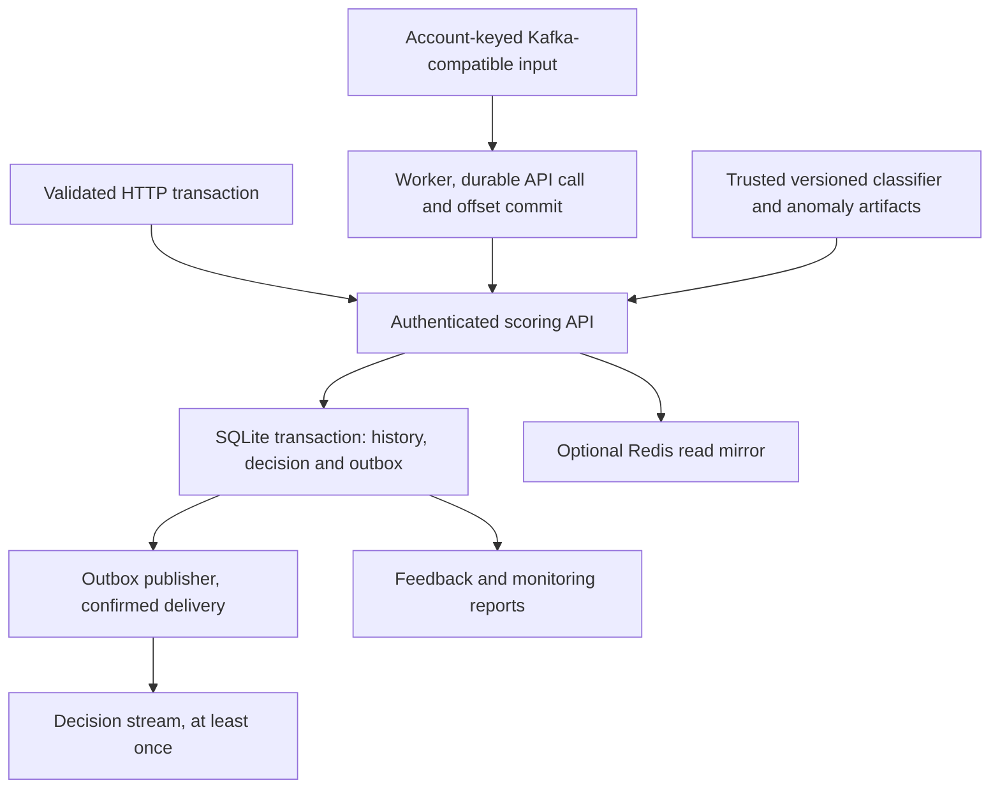

# Sentinel — technical interview guide

Stage 4 review: 27 October 2026. Describe the actual reference platform and its measured limits. Confirm personal contributions separately before using first-person authorship claims.

## Evidence boundary

| Item | Status and scope |
| --- | --- |
| Reviewed source | **VERIFIED by inspection:** base `fc290021b9b00c19cead9ce7ed07ff04555b0f85` plus existing uncommitted Stage 1 request-boundary/security and Stage 2 demo/telemetry changes. Use `git diff HEAD` and untracked-file status; the base SHA alone is incomplete identity. |
| Stage 4 selected checks | **VERIFIED locally:** 21 tests passed for transactional scoring/replay/conflict, rollback/reload, request boundaries, HTTP rejection telemetry and mocked stream/outbox behavior. No broker or real financial transactions were used. |
| Earlier Stage 2 native service | Recorded 24-test suite pass and 200 synthetic HTTP load requests at concurrency 2 with zero load errors/timeouts. p50 8.311 ms, p95 27.651 ms on that native local workload; no cgroup resource cap. [Deployment procedure](DEPLOYMENT_DEMO.md). These are historical run observations, not a capacity guarantee. |
| Container/public service | **BLOCKED:** Stage 2 image build/capped test after a Docker Hub timeout and remote-host failures. **UNVERIFIED:** new public backend and hosted load. A browser demo, image recipe or Render draft does not establish that backend deployment. |
| Model evidence | [Validation](VALIDATION.md) and [real-data benchmark](REAL_BENCHMARK.md) have their own protocols. Synthetic serving checks do not establish real-world fraud accuracy or savings. |

## 60-second pitch

Sentinel is a fraud decisioning reference platform that combines a model with explicit transaction-processing semantics. FastAPI accepts validated events; account-keyed Kafka-compatible input is an optional second path. One SQLite transaction checks idempotency, reads bounded preceding account history, computes features, scores the model and stores the decision, updated history and output outbox. Identical retries replay the original result, while changed payloads under the same ID are conflicts. Risk combines XGBoost output with an Isolation Forest anomaly percentile and explicit review rules. Versioned artifacts support guarded promotion and rollback. Streaming output is at least once, with downstream deduplication required. The project is useful for explaining correctness across retries, failures and model versions; it does not establish bank production readiness, calibrated risk probabilities or customer savings.

## Three-minute walkthrough

**0:00–0:40 — Define the transaction boundary.** Start at [api.py](../fraud/api.py) · `create_app.score`, then [store.py](../fraud/store.py) · `Store.score`. Show the payload fingerprint and `BEGIN IMMEDIATE`. The same ID and normalized payload returns its original decision; a changed payload returns 409. A model exception rolls back account history, decision and outbox together. Keeping scoring inside the writer transaction is simple and correct for this workload, but serializes writes and can hurt tail latency.

**0:40–1:20 — Features, scoring and explanations.** In [features.py](../fraud/features.py), show history before the current event, the account watermark and bounded 24-hour/1,000-event state. Equal timestamps follow arrival order; older timestamps are rejected. [ModelManager.score](../fraud/model.py) mixes 95% classifier output with 5% anomaly percentile. A threshold produces BLOCK, 65% of it starts REVIEW, and explicit rules can raise APPROVE to REVIEW. Tree SHAP explains the classifier margin, not the blend or business causation.

**1:20–2:00 — Persistence and streaming.** Explain that Redis is an optional read mirror; SQLite owns correctness. In [worker.py](../fraud/worker.py), show manual input-offset commit after durable API success. Invalid/conflicting/late events need confirmed dead-letter publication before commit. Output uses the SQL outbox. A crash after publication but before marking delivery can publish twice; consumer idempotency is necessary. Do not call this cross-system exactly once.

**2:00–3:00 — Operate and limit the claim.** Show authenticated readiness/model/metrics paths, production-key guard and actual-body cap. Use [the selected tests](../tests/test_platform.py) to demonstrate replay, failure rollback, artifact corruption and pointer rollback. Model promotion uses validation gates; feedback/PSI monitoring only recommends investigation or retraining, not automatic promotion. Finish by distinguishing the prior native synthetic load from a hosted or container-capped run: the new public deployment remains blocked, and no production accuracy, throughput or financial return is established.

## Architecture



The standalone Stage 2 demo runs one API worker with ephemeral SQLite and no broker/outbox publisher. The diagram's streaming path describes the optional full topology, not services included in the proposed minimal deployment.

## One end-to-end execution trace

Trace `POST /v1/score`, retry the same payload, then reuse its ID with a changed amount:

| Step | Path and symbol | Observable behavior |
| --- | --- | --- |
| 1 | [middleware.py](../fraud/middleware.py) · `BodyLimitMiddleware`; [schema.py](../fraud/schema.py) · `Transaction`; [api.py](../fraud/api.py) · `auth` | Actual received body cap of 65,536 bytes, typed input validation and constant-time key comparison protect the scoring route. The production guard rejects the public demo/short key before state initialization. |
| 2 | [api.py](../fraud/api.py) · `create_app.score`; [store.py](../fraud/store.py) · `Store.score` | Canonical payload hash and `BEGIN IMMEDIATE`; identical retry returns `replayed=True`, changed payload raises `Conflict`. Both bypass fresh scoring/history advance. |
| 3 | [store.py](../fraud/store.py) · `Store.score`; [features.py](../fraud/features.py) · `extract` | Reject an event older than its account watermark; compute features from previously ingested history without the current label/event. |
| 4 | [model.py](../fraud/model.py) · `ModelManager.load`, `ModelManager.score` | Load a trusted checksum-checked version, compute classifier/anomaly blend, thresholds/rules and classifier contribution reasons. |
| 5 | [features.py](../fraud/features.py) · `advance`; [store.py](../fraud/store.py) · `Store.score` | Commit payload/features/result, bounded account history/watermark and one outbox row atomically. Failure rolls back the transaction. |
| 6 | [api.py](../fraud/api.py) · `create_app.score`, `create_app.request_telemetry` | Optional Redis cache write does not determine success. Return durable decision; record whole-request metrics and generated request ID, including rejected requests. |
| 7 | [worker.py](../fraud/worker.py) · `drain_outbox`, `publish`; [store.py](../fraud/store.py) · `Store.delivered` | In the full streaming topology only, publish pending rows and mark delivered after confirmation. Crash between these steps can duplicate output. |

Start with [test_duplicate_and_payload_conflict](../tests/test_platform.py), then [test_atomic_failure](../tests/test_platform.py) and [mocked delivery tests](../tests/test_stream.py). These tests use temporary state and do not need Kafka or Redis.

## Decisions, alternatives and trade-offs

| Current decision | Cost or limit | When to reconsider |
| --- | --- | --- |
| SQLite is the correctness store; [store.py](../fraud/store.py) | Model inference holds a serialized write transaction; one-node availability and write throughput are limited. | Measured concurrency/availability needs could justify shared transactional state and account-level concurrency control. |
| Account watermark and bounded history; [features.py](../fraud/features.py), [store.py](../fraud/store.py) | Late events are rejected; 1,000-event truncation can lose part of a high-rate account's 24-hour history. | Define event-time tolerance, correction semantics and feature-state bounds for an actual workload. |
| Transactional output outbox plus manual offsets; [worker.py](../fraud/worker.py) | Delivery can duplicate; a shared database does not automatically coordinate several publishers. | Explicit ownership/leases and downstream deduplication for multi-worker operation, with crash tests. |
| 95/5 classifier/anomaly blend; [model.py](../fraud/model.py) | Fixed heuristic blend; raw outputs and composite risk are not calibrated loss probabilities. | An ablation and calibration study on representative mature labels, with review-capacity/cost assumptions. |
| Immutable version folders and atomic pointer; [model.py](../fraud/model.py), [train.py](../fraud/train.py) | Locally trusted pickle artifact; concurrent promoters are unsupported. | Authenticated artifact provenance, safe loading policy and serialized promotion for real shared deployments. |
| PSI/observed-label monitoring; [monitor.py](../fraud/monitor.py) | Drift can reflect seasonality; selectively reviewed labels bias performance estimates. | Representative mature-label cohorts, segment monitoring and a validated retraining/promotion policy. |

## Challenging questions and accurate answers

**Is processing exactly once?** A new transaction ID creates one durable local decision/history advance/outbox row under the SQLite transaction. Kafka publication and SQL delivered marking are separate operations, so output is at least once. Producer idempotence alone does not remove duplicates after a publisher crash/restart. Downstream consumers need deduplication by transaction ID.

**Why preserve the original decision on a retry after model promotion?** Idempotency means the same event replays its committed result, including its model version. Re-scoring would change the event's historical meaning and could double-advance features. A separately defined rescore workflow would need separate identity/audit semantics.

**What is the cost of scoring inside `BEGIN IMMEDIATE`?** It couples history, score and outbox atomically, with straightforward rollback. It also holds the writer lock during inference and model reload, so slow scoring delays other writes. A future design must preserve account order/idempotency rather than merely move inference outside the transaction.

**What do SHAP reasons cover?** Native Tree SHAP decomposes the classifier margin in log-odds. The returned positive contributions do not explain the anomaly percentile, blend, review rules, calibrated probability or causal effect. [Model implementation](../fraud/model.py), [longer interview guide](INTERVIEW_GUIDE.md).

**Can high classifier accuracy establish a good fraud detector?** Not with strong class imbalance. The real-data benchmark reports ranking and operating-point measures under its own chronological split and cost assumptions. Supplied upstream PCA provenance and representative production labels remain limitations. Synthetic serving behavior is a separate result; see [REAL_BENCHMARK.md](REAL_BENCHMARK.md).

**Does drift automatically deploy a new model?** No. PSI is an investigation/retrain heuristic. [retrain.py](../fraud/retrain.py) creates a candidate under its trigger or explicit force flag; [train.py](../fraud/train.py) requires explicit promotion and validation gates. No built-in schedule or automatic promotion is established.

**Do checksums make pickle safe?** No. They detect a mismatch against the metadata supplied with a trusted local model. An attacker who replaces both can satisfy those checks and execute malicious pickle content. Model directories are operator-trusted inputs, never arbitrary user uploads.

**Can the minimal demo prove streaming or persistence across host restarts?** No. It omits the publisher/broker, uses one worker and intentionally temporary storage. Native scoring success does not establish image build, cgroup compliance, hosted TLS/cold starts or durable public service operation. [Deployment contract](DEPLOYMENT_DEMO.md).

## Supported failure and debugging examples

| Case | Established behavior/evidence | What remains a hypothesis |
| --- | --- | --- |
| Scoring exception | [test_atomic_failure](../tests/test_platform.py) verifies rollback; retrying the same ID can succeed once the injected failure is removed. | A new 503 could come from model, storage or artifact reload. Inspect logs/state before assigning its cause. |
| Replayed or conflicting ID | [Replay/concurrent-idempotency tests](../tests/test_platform.py) preserve one decision and reject a changed payload. | Idempotency does not establish event authenticity or fair model outcomes. |
| Unconfirmed DLQ/outbox publication | [test_dlq_failure_does_not_commit and test_outbox_delivery_failure_retains_pending](../tests/test_stream.py) keep the offset/pending row when delivery fails. | Mocked transport failure checks are not live broker recovery or cross-system exactly-once evidence. |
| Body limit/rejection invisibility | [Request-boundary tests](../tests/test_request_boundaries.py) check actual-body caps; [HTTP telemetry regression](../tests/test_platform.py) checks 401/422/413 metrics without submitted IDs/keys in request telemetry. | These checks do not establish a complete public abuse-control/privacy program. |
| Proposed image could not be verified | Stage 2 Docker Hub pull timed out; later remote operations failed. Native checks passed separately. [Deployment procedure](DEPLOYMENT_DEMO.md). | Missing build/access evidence is not proof that the image or model is defective. |

## Limits and useful next validation

- Single-node writes, trusted model artifacts, bounded account history, strict late-event policy, selected feedback labels and process-local service configuration are confirmed boundaries.
- **BLOCKED/UNVERIFIED:** the new image/capped verification and public backend; no Stage 4 deployment attempt or current hosting-price claim is made.
- Real-world calibration, mature-label performance, segment/fairness review, sustained concurrent capacity and durable multi-publisher behavior need their own requirements and evidence.
- Prioritize validated model/threshold economics and a separately reviewed persistence/concurrency plan before expanding infrastructure. The existing minimal deployment can be resumed independently when its access/publication blockers are resolved.

## Personal contribution and AI assistance

| Claim | Evidence/status | Owner confirmation needed |
| --- | --- | --- |
| Code, tests, benchmarks and documentation | AI-assisted work is disclosed in [OWNERSHIP.md](OWNERSHIP.md). | Identify actual personally authored/reviewed components and commits. |
| Personal replay/conflict exercise or experiment | Pending in the existing contribution record. | Real commands/output, explanation, change and date after completing it. |
| Production fraud ownership, customers or savings | **UNVERIFIED; not established by synthetic or offline data.** | Separate supporting real-world facts if any. |
| Independent understanding | Preparation material alone does not establish it. | Explain the transaction, failure and model boundaries without reading the guide. |

No absence of a recorded personal contribution implies that no personal work exists. Confirm evidence before filling the log or using a first-person resume verb.

## Practical rehearsal checklist

Use the existing Python 3.12 environment. For a new environment, follow the pinned Linux Python 3.12 lock/development setup in [README](../README.md). Run from the repository root:

```bash
git rev-parse HEAD
git status --short
git diff HEAD -- fraud scripts tests deploy
.venv/bin/python -m pytest -q tests/test_platform.py tests/test_request_boundaries.py tests/test_stream.py
```

The tests train isolated small synthetic fixtures. A manual API demo first needs a trained/promoted model and owned `DATA_DIR`/`MODEL_DIR`; follow [the deployment/demo procedure](DEPLOYMENT_DEMO.md). Do not overwrite historical models/state to simplify rehearsal. Public deployment, paid hosting and a load test against another system are separate actions requiring their scoped authorization.

- [ ] Predict identical replay, changed-ID payload conflict, late event and failure rollback results before executing tests.
- [ ] Trace feature history before the current event; explain equal timestamps and 1,000-event truncation.
- [ ] Compute one blend/threshold/rule example and distinguish classifier output from calibrated risk.
- [ ] Draw crash points around input commit, outbox publish and delivered marking; identify where duplicates can occur.
- [ ] Explain model pointer rollback and why prior decisions keep the old model version.
- [ ] Distinguish native local load, browser demo, container test and hosted backend evidence.
- [ ] Add only completed personal work to [OWNERSHIP.md](OWNERSHIP.md). Continue with [practice](INTERVIEW_PRACTICE.md) and [the detailed guide](INTERVIEW_GUIDE.md).
